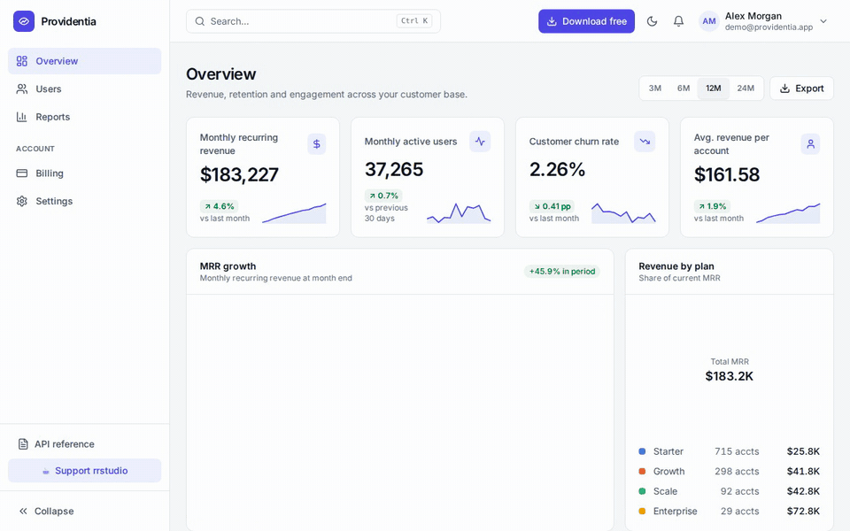
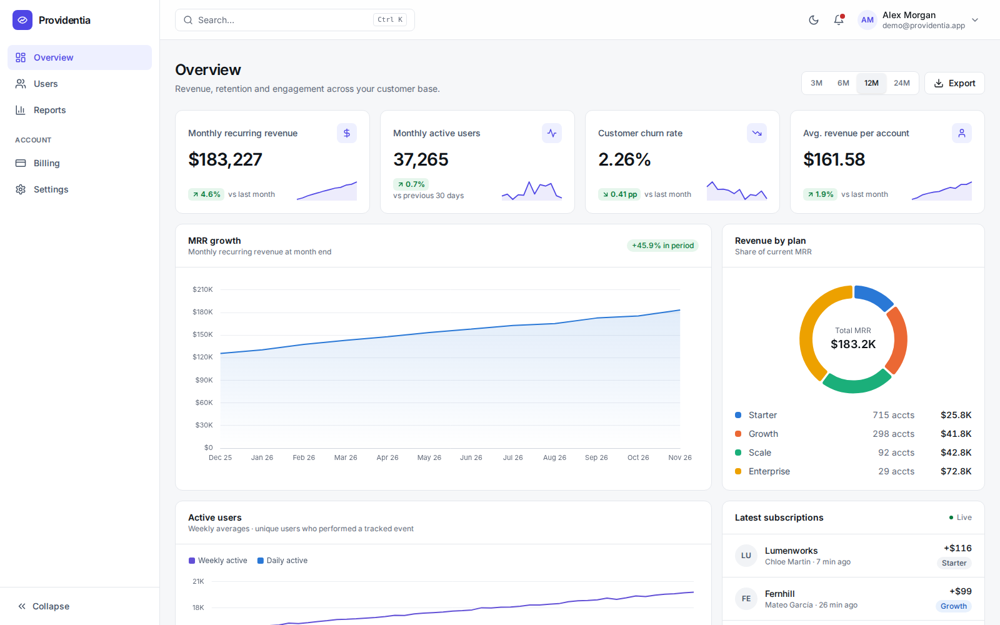
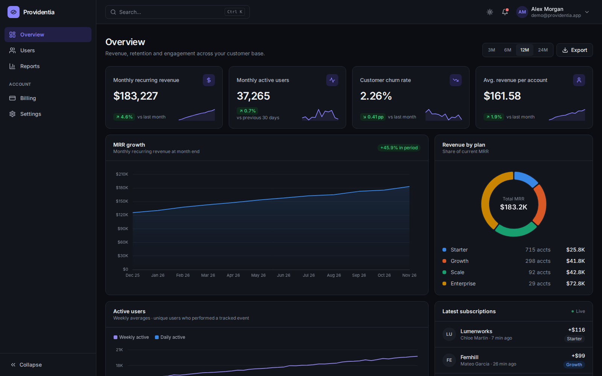
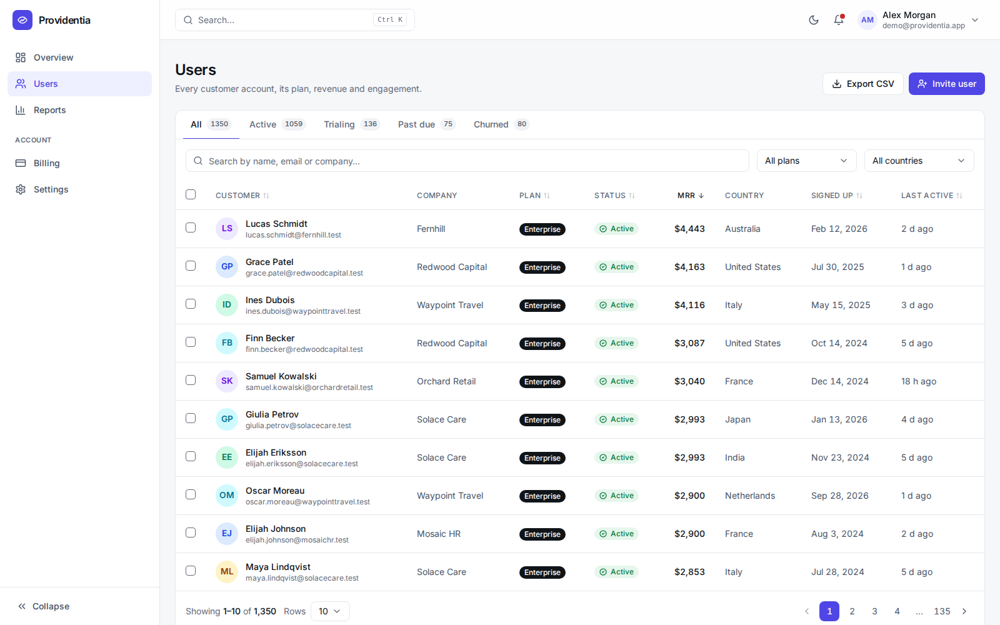
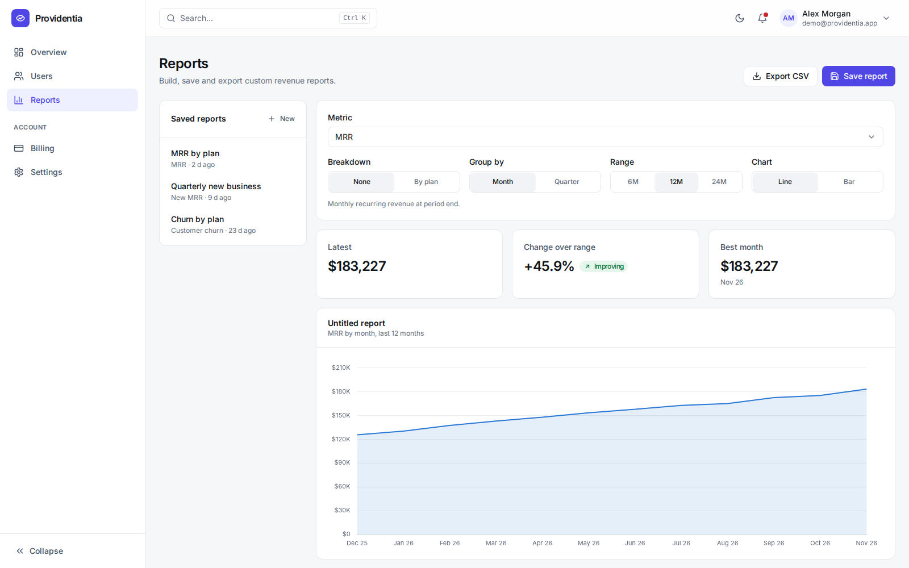
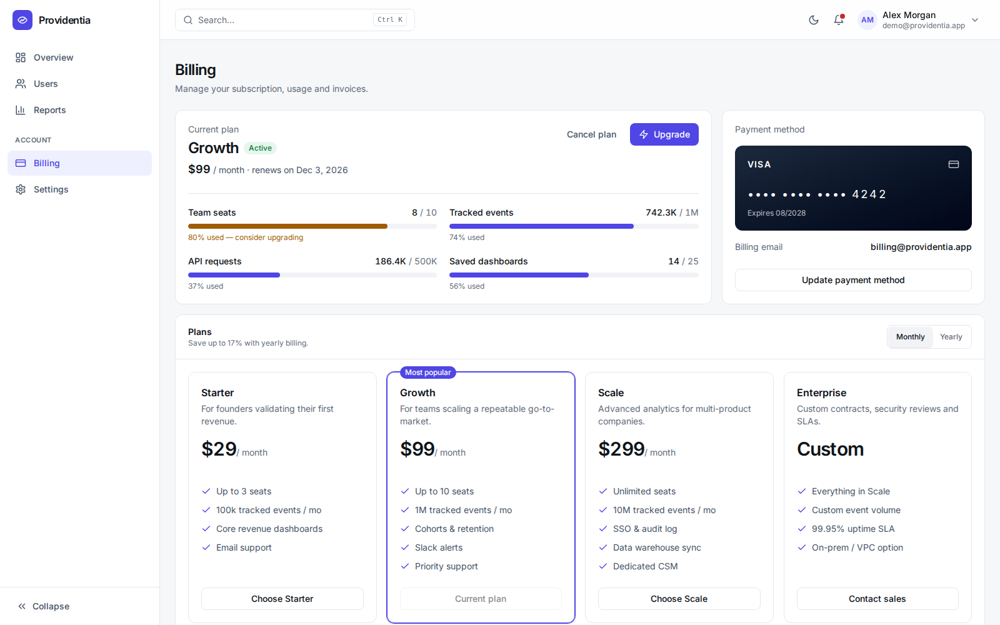
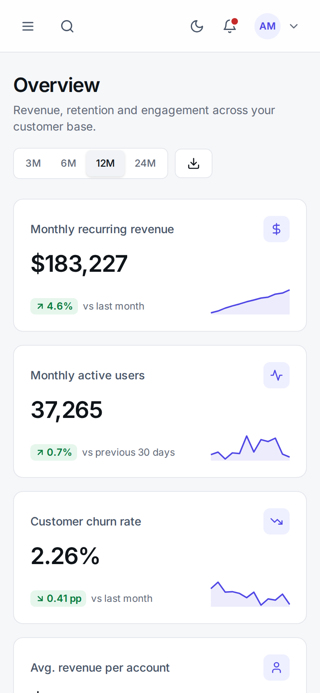

# Providentia — SaaS Analytics Dashboard for Angular

A free, production-ready admin dashboard template for SaaS products by **rrstudio**: revenue KPIs,
churn, active users, cohort retention, a customer table with full CRUD, a report builder, billing
and account settings — with light/dark mode, six accent colors and a fully responsive layout.

Built with the latest stable Angular and modern APIs only: **standalone components, signals,
`rxResource`, `linkedSignal`, Signal Forms, zoneless change detection, new control flow**.

**[Try the live demo →](https://demo.rr-dev.eu/providentia/overview)** — no sign-up, runs entirely
in your browser on generated data.

> **About this repository:** this is the public home of Providentia — screenshots, release notes,
> bug reports and feature requests. The source code is distributed through
> **[Polar](https://buy.polar.sh/polar_cl_qkpmJsVoK393Bp6lfOAEBDXz3r7wDIzUDs1wO2p31hb)**: it is **free** (pay what you want, $0 is fine) and you always get the latest
> version.

---

## Screenshots

| Overview (light) | Overview (dark) |
|---|---|
|  |  |

| Users | Reports |
|---|---|
|  |  |

| Billing | Mobile |
|---|---|
|  |  |

---

## Features

- **Overview** — KPI cards (MRR, monthly active users, churn rate, ARPU) with deltas and sparklines;
  MRR growth, revenue by plan, daily/weekly active users, MRR movements and a cohort retention
  heatmap. Date range filter (3M/6M/12M/24M) and CSV export.
- **Users** — status tabs with live counts, debounced search, filters, sortable columns, pagination
  (all kept in the URL), multi-select with bulk export and bulk delete, invite / edit / delete
  dialogs, customer detail drawer with "view as customer". On phones the table becomes a card list.
- **Reports** — report builder (metric, breakdown, time grouping, range, chart type) with summary
  cards, chart and table; saved reports and CSV export.
- **Billing** — current plan, usage meters, payment method form with card validation, plan
  comparison, plan change and cancel/resume flows, invoice history.
- **Settings** — Profile (with photo upload), Notifications, Appearance and Security as
  deep-linkable tabs, with dirty tracking, validation and server-side field errors. Appearance
  includes a **theme configurator**: light / dark / system, six accent colors (all WCAG AA in both
  themes) and comfortable / compact density.
- **Auth** — login, registration with password strength meter, forgot/reset password, onboarding
  wizard, return-URL redirect after login.
- **Global** — command palette (Ctrl/⌘ K), notification feed, in-app 404 page.

**Under the hood**

- Every route is **lazy loaded**; mock data and ECharts never land in the initial bundle.
- **Swappable API layer**: realistic mock data or HttpClient with one switch. Every endpoint is
  described in an **OpenAPI 3.1** contract
  ([API reference](https://demo.rr-dev.eu/docs/providentia/)).
- Loading skeletons, empty and error states with Retry on every page — the demo lets you simulate a
  slow network and API errors from Settings → Appearance.
- **Accessible**: semantic landmarks, ARIA on tabs, menus and dialogs, full keyboard support,
  visible focus, WCAG AA contrast, color-blind safe chart palette.
- **Tested**: unit tests with Vitest and end-to-end tests with Playwright (desktop and mobile).
- No UI-library lock-in: small, readable components you own.

## Tech stack

| | |
|---|---|
| Framework | Angular 22 (standalone, zoneless, OnPush everywhere) |
| State | Signals, `computed`, `linkedSignal`, `rxResource` |
| Forms | Angular Signal Forms |
| Styling | Tailwind CSS 4 with semantic design tokens |
| Charts | Apache ECharts 6 via `ngx-echarts` (tree-shaken, lazy-loaded) |
| Icons | Lucide (inline SVG) |
| Tests | Vitest, Playwright |

## Get it

1. **[Download Providentia for free on Polar](https://buy.polar.sh/polar_cl_qkpmJsVoK393Bp6lfOAEBDXz3r7wDIzUDs1wO2p31hb)** — enter $0 or any amount you like.
2. Unzip, then `npm install` and `npm start`. The included README covers installation,
   connecting your own API, theming, adding pages and deployment.

New versions are announced in [Releases](../../releases). Downloading again from Polar always gives
you the latest one.

## Feedback

- Found a bug? [Open a bug report](../../issues/new?template=bug_report.yml).
- Missing something? [Request a feature](../../issues/new?template=feature_request.yml).
- Anything else: [rrstudio.apps@gmail.com](mailto:rrstudio.apps@gmail.com).

## License

Providentia is free to use in your personal and commercial projects, including projects for your
clients. You may not resell or redistribute the template itself as a template, theme or UI kit.
The full terms are in the **rrstudio Template License** shipped with the download — see
[LICENSE](LICENSE).

## Support

Providentia is free. If it saves you time, you can support its development on
[Ko-fi](https://ko-fi.com/rrstudioapps) ☕ — thank you!
